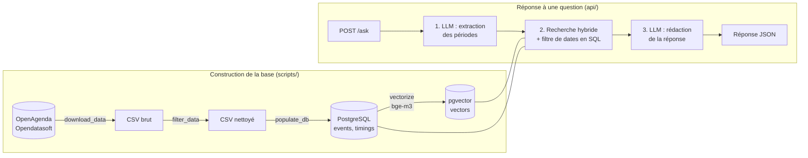

# Rapport technique – Assistant de recommandation d'événements culturels

POC réalisé pour Puls-Events : un chatbot qui répond en langage naturel à des questions sur les événements culturels, à partir des données OpenAgenda. Les instructions d'installation et d'exécution sont dans le [README](../README.md).

## 1. Objectifs du projet

**Contexte.** Puls-Events veut savoir si sa plateforme peut intégrer un assistant capable de répondre à des questions comme « Un concert de jazz à Bordeaux ce week-end ? », en s'appuyant sur les événements publics d'OpenAgenda.

**Problématique.** Une recherche par mots-clés gère mal ces questions, qui combinent un type d'événement, un lieu et une période souvent exprimée de façon relative (« demain soir », « tous les samedis »). Un LLM seul ne connaît pas les événements à venir et risque d'en inventer. Un système RAG combine les deux : on retrouve d'abord les événements pertinents dans la base, puis le LLM rédige une réponse fondée uniquement sur eux.

**Objectif du POC.** Démontrer la faisabilité technique (chaîne complète, des données brutes à une API), la valeur métier (réponses pertinentes et fiables) et mesurer la qualité des réponses.

**Périmètre.** Toute la France métropolitaine, pour des événements dont la première date se situe entre le 1er septembre 2025 et le 1er septembre 2027 (environ un an d'historique et un an à venir au moment du téléchargement, le 21/09/2026). Cela représente 244 922 événements et 689 599 créneaux horaires. Plutôt que de restreindre la zone, on laisse la recherche et le LLM gérer le lieu demandé.

## 2. Architecture du système



| Rôle | Technologie |
|---|---|
| Stockage des événements, des vecteurs et des métadonnées | PostgreSQL 18 + pgvector, schéma versionné avec Alembic, accès via SQLAlchemy |
| Embeddings | BAAI/bge-m3 (FlagEmbedding), exécuté en local sur CPU |
| LLM | Claude Haiku 5.5 (API Anthropic) |
| API | FastAPI + Uvicorn, documentation Swagger automatique |
| Évaluation | pytest, DeepEval (Claude comme juge) |
| Déploiement | Docker (image autonome), dépendances gérées avec uv |

**Écarts par rapport aux outils suggérés (Faiss, LangChain, Mistral).**
- **pgvector plutôt que Faiss.** Les vecteurs, les métadonnées et les dates des événements sont dans une même base. Le filtre sur la période demandée s'applique donc dans la même requête SQL, *avant* la limite des k meilleurs résultats. Avec Faiss, il faudrait filtrer après coup : on risquerait de récupérer 30 événements dont la plupart tombent hors de la période. pgvector gère aussi les vecteurs creux (recherche hybride) et apporte la persistance et les mises à jour incrémentales.
- **bge-m3 plutôt que l'API d'embeddings Mistral.** Il est gratuit et local, ce qui compte pour vectoriser environ 255 000 documents. Il est multilingue, avec un bon niveau en français. Il produit en une seule passe un vecteur dense et un vecteur creux (poids lexicaux), ce qui permet la recherche hybride.
- **Claude plutôt que Mistral.** Les sorties structurées (réponse conforme à un schéma Pydantic) fiabilisent l'extraction des dates. Le modèle reste interchangeable via la variable `LLM_MODEL`.
- **Pas de LangChain.** La chaîne se limite à deux appels au LLM et une requête SQL. Des appels directs au SDK restent plus simples à lire, à déboguer et à tester. La recherche hybride avec filtre temporel en SQL n'est de toute façon pas couverte par les intégrations vectorielles standard de LangChain.

## 3. Préparation et vectorisation des données

**Source.** Jeu de données `evenements-publics-openagenda` de public.opendatasoft.com, exporté en CSV par tranches de 90 jours sur `firstdate_begin`, car un export est limité en nombre de lignes.

**Nettoyage** ([scripts/filter_data.py](../scripts/filter_data.py)) :

| Étape | Événements restants |
|---|---|
| Téléchargés (première date entre 09/2025 et 09/2027) | 263 628 |
| France métropolitaine uniquement | 250 676 |
| Description et titre renseignés | 250 238 |
| Suppression des doublons (titre, première date, lieu, descriptions) | 244 922 |
| Créneaux horaires cohérents (début ≤ fin) | 244 922 |

On a aussi retiré le HTML des descriptions longues (BeautifulSoup) et simplifié le mode de participation (1 : sur place, 2 : en ligne, 3 : mixte ; sur place par défaut). Les colonnes inutiles ont été supprimées. Les événements et leurs créneaux sont ensuite stockés dans PostgreSQL ([scripts/populate_db.py](../scripts/populate_db.py)) : une ligne par événement, une ligne par créneau.

**Chunking** ([scripts/vectorize.py](../scripts/vectorize.py)). Chaque document se compose d'un en-tête (titre, mots-clés, lieu complet) suivi de la description courte et longue. Le document le plus long fait 10 181 caractères, bien en dessous de la limite de bge-m3. On découpe quand même les descriptions en morceaux d'au plus 1 600 caractères (environ 500 tokens, à raison de 3,25 caractères par token), avec un recouvrement d'au plus 320 caractères (environ 20 %), en coupant sur la ponctuation. Ces valeurs suivent les recommandations courantes (512 à 1 024 tokens, 10 à 20 % de recouvrement). L'en-tête est répété dans chaque morceau, pour que chacun porte le titre et le lieu. Résultat : 255 224 morceaux pour 244 922 événements.

**Embeddings.** bge-m3 en fp32 sur CPU, par lots de 16 (des lots de 8 à 16 se sont révélés plus rapides que 32). Chaque morceau reçoit un vecteur dense de 1 024 dimensions et un vecteur creux (poids lexicaux sur un vocabulaire de 250 002 tokens). Ollama était plus rapide (0,03 s par document contre 0,056 s) mais ne fournit que le vecteur dense. La vectorisation complète prend environ 12 heures. Le script avance donc par lots de 1 000 événements validés en base et reprend où il s'était arrêté en cas d'interruption.

## 4. Choix du modèle de langage

**Modèle.** Claude Haiku 5.5, avec un effort de raisonnement réglé sur `low`. Il est rapide et peu coûteux, et largement suffisant pour ces deux tâches. Le modèle se change par configuration.

**Prompting** ([api/llm.py](../api/llm.py)) — deux appels par question :
1. **Extraction des périodes.** Le LLM renvoie, selon un schéma imposé, la liste des périodes qui intéressent l'utilisateur. Chaque période comprend une date de début et de fin, des jours de la semaine et une plage horaire. Le prompt donne des règles explicites (« ce week-end », « tous les mercredis », « le soir » = 18h–23h59…) et des exemples. Sans indication de date, la période par défaut couvre les 30 prochains jours. Ces périodes sont ensuite converties en intervalles précis par du code Python testé ([api/dates.py](../api/dates.py)).
2. **Rédaction de la réponse.** Le LLM reçoit au plus 30 événements candidats, avec leur titre, mots-clés, lieu, créneaux dans la période, conditions, âges, lien et description. Les consignes : n'utiliser que ces événements, ne rien inventer, répondre dans la langue de la question, ne pas mentionner les candidats écartés. Si rien ne correspond, il doit le dire clairement puis proposer au plus 3 alternatives, présentées comme telles.

**Limites.** Le système dépend d'une API externe (connexion, clé, coût à chaque question). Il faut compter environ 10 s par question. Les réponses varient d'un appel à l'autre, et une réponse très longue peut être coupée par la limite de tokens.

## 5. Construction de la base vectorielle

**Stockage.** Table `vectors` (identifiant, `event_uid`, `vector VECTOR(1024)`, `sparse SPARSEVEC(250002)`), liée aux tables `events` (titre, descriptions, mots-clés, lieu, coordonnées, âges, accessibilité, lien) et `timings` (début et fin de chaque créneau). La persistance est assurée par PostgreSQL lui-même : pas de fichier d'index à sauvegarder, et le schéma est versionné par une migration Alembic.

**Recherche** ([api/retrieval.py](../api/retrieval.py)). La question est encodée par bge-m3. Le score d'un morceau est la somme du produit scalaire dense et du produit scalaire creux, à poids égaux. On garde le meilleur morceau de chaque événement, puis seuls les événements ayant au moins un créneau qui chevauche les intervalles demandés (opérateur `&&` sur un `tsmultirange`). Enfin, on retient les 30 meilleurs. La recherche est exacte, sans index approximatif. Sur 255 000 vecteurs, elle prend moins d'une seconde par question : les 13 tests de recherche tournent en 10 s, chargement du modèle compris.

## 6. API et endpoints exposés

Application FastAPI ([api/app.py](../api/app.py)), séparée de la logique RAG. Le modèle bge-m3 est chargé une seule fois, au démarrage, puis partagé entre les requêtes. La documentation interactive est disponible sur `/docs`.

| Endpoint | Rôle |
|---|---|
| `POST /ask` | Corps `{"question": "..."}`. Renvoie la réponse, la période comprise et les événements candidats (uid, titre, ville, lien, score). |
| `POST /rebuild` | Lance la vectorisation en arrière-plan et répond aussitôt (202). Option `{"reset": true}` pour tout reconstruire au lieu de compléter. Protégeable par un jeton (`ADMIN_TOKEN`, en-tête `X-Admin-Token`). |
| `GET /rebuild` | État de la dernière reconstruction (en cours, dates, erreur éventuelle). |
| `GET /health` | Vérification que l'API répond. |

**Gestion des erreurs.**

| Code | Cas |
|---|---|
| 422 | Question vide, absente ou mal formée |
| 502 | Échec de l'appel au LLM |
| 503 | Erreur de base de données |
| 401 | Jeton invalide sur `/rebuild` |
| 409 | Reconstruction déjà en cours |

**Exemple d'appel :**
```
curl -X POST http://127.0.0.1:8000/ask -H "Content-Type: application/json" -d "{\"question\": \"Un concert de jazz à Bordeaux\"}"
```

**Tests.** [tests/api_test.py](../tests/api_test.py) contient 14 tests fonctionnels, où le modèle, le RAG et la vectorisation sont simulés : réponse nominale, questions invalides, erreur de base, reconstruction, conflit, jeton. Un test de bout en bout, optionnel, utilise les vrais composants.

**Conteneurisation.** Le [Dockerfile](../Dockerfile) produit une image autonome d'environ 6 Go, qui contient le code, les dépendances (PyTorch CPU) et le modèle bge-m3. La base de données reste à l'extérieur, joignable via `DATABASE_URL`, comme elle le serait en production.

## 7. Évaluation du système

**Jeu de test annoté** ([tests/data/questions.json](../tests/data/questions.json)). Il compte 17 questions rédigées à la main pour couvrir les formulations de dates : sans date, date explicite, ce soir, demain matin, week-end, semaine prochaine, mois, jours multiples, deux créneaux distincts, récurrence, passé, après une heure donnée. Deux questions n'ont volontairement aucune réponse possible. Chaque question est annotée avec les périodes attendues, et 13 d'entre elles avec des identifiants d'événements pertinents présents dans la base. La date de référence est fixée au vendredi 20/11/2026, pour que les annotations restent valables.

**Quatre niveaux de tests :**

| Niveau | Ce qui est vérifié | Résultat |
|---|---|---|
| Unitaire (32 tests, sans dépendance externe) | Conversion des périodes en intervalles | 32/32 |
| Extraction des dates (LLM) | Périodes extraites = périodes attendues, comparées après conversion en intervalles | 20/20 au premier passage (20 questions) |
| Recherche (base + bge-m3) | Les événements attendus figurent dans les 30 résultats | 13/13 |
| RAG complet (DeepEval, juge Claude) | Qualité de la réponse finale (métriques ci-dessous) | 10/17 |

**Métriques du RAG complet**, notées de 0 à 1 par un LLM juge :
- **Faithfulness** (seuil 0,8) : chaque affirmation de la réponse doit être appuyée par les événements récupérés.
- **Answer relevancy** (seuil 0,7) : la réponse traite la question. Non calculée pour les questions sans réponse possible.
- **Respect des contraintes** (critère G-Eval personnalisé, seuil 0,7) : les événements recommandés correspondent au lieu, au type et à la période demandés. Si rien ne correspond, la réponse doit le dire.

**Analyse quantitative.** Dernier passage (27/11/2026, juge Claude Haiku 5.5, coût du juge environ 0,15 $) : 10 questions sur 17 réussissent les trois métriques. Les moyennes sont de 0,96 en fidélité, 0,78 en respect des contraintes et 0,92 en pertinence. Le résultat dépend nettement du juge et du passage : un passage antérieur avec Claude Sonnet 5.5 comme juge obtenait 16/20, et les scores varient d'environ ±0,1 d'un passage à l'autre.

**Analyse qualitative.**
- **Points forts.** Le système n'invente pas d'événements : la fidélité est proche de 1, et les écarts viennent de petits détails ajoutés. Les périodes sont bien comprises et respectées, y compris les formulations difficiles (deux créneaux distincts, récurrences, passé). Quand rien ne correspond, la réponse le dit honnêtement.
- **Points faibles.** La recherche vectorielle tient peu compte du lieu. Pour « une visite guidée à Marseille », les premiers résultats étaient des visites guidées à Roubaix ou à Lille. Le LLM écarte ces candidats, mais les places perdues réduisent le choix. Certains événements sont publiés plusieurs fois sous des identifiants différents et occupent plusieurs places dans les 30 résultats. Les contraintes de récurrence ne sont pas gérées, qu'elle soit dans le temps (« un festival qui a lieu tous les ans ») ou dans l'espace (un spectacle en tournée dans plusieurs villes). Chaque édition ou chaque date de tournée est un événement distinct, et rien dans les données ne les relie. Enfin, le juge est parfois incohérent, en particulier sur les alternatives proposées quand rien ne correspond.

## 8. Recommandations et perspectives

**Ce qui fonctionne.** La chaîne est complète et automatisée, des données brutes à une API conteneurisée. La compréhension des dates est fiable, les réponses ne contiennent pas d'invention, et les tests sont automatisés à chaque niveau.

**Limites du POC.**
- **Volumétrie :** vectorisation de 12 h sur CPU, recherche exacte sans index.
- **Coût et latence :** deux appels au LLM par question, environ 10 s par réponse.
- **Lieu :** il n'est pris en compte que par la similarité sémantique.
- **Contraintes complexes :** la récurrence d'un événement (annuel, en tournée) n'est pas exploitable.
- **Évaluation :** jeu de test réduit et juge lui-même variable.

**Améliorations possibles, par impact attendu :**
1. **Filtrer par lieu :** extraire la ville ou le département dans le premier appel au LLM, avec les dates, et filtrer en SQL comme pour les périodes.
2. **Dédoublonner les événements** par titre et lieu, à la recherche ou dans les données.
3. **Gérer la récurrence :** relier les éditions d'un même événement, d'une année à l'autre ou d'une ville à l'autre pour une tournée (par titre, organisateur et description), afin de répondre à « tous les ans » ou « en tournée ». Cela demande un historique plus long que les deux ans actuels.
4. **Affiner le prompt de réponse :** limiter le nombre de recommandations, détecter les réponses tronquées.
5. **Élargir le jeu de test**, moyenner plusieurs passages et mesurer la recherche seule avec une métrique dédiée.
6. **Passer à l'échelle :** index HNSW sur les vecteurs, index sur `timings.event_uid`, éventuellement un reranker.

**Passage en production.** Base managée, mise à jour planifiée des données OpenAgenda (téléchargement puis vectorisation incrémentale via `/rebuild`), authentification et limitation de débit sur l'API, suivi des coûts et des temps de réponse, intégration continue (tests unitaires à chaque commit, évaluation RAG à la demande).

## 9. Organisation du dépôt

```
api/            logique RAG (dates, recherche, appels LLM, pipeline) et application FastAPI (app.py)
scripts/        téléchargement, nettoyage, import en base, vectorisation
models/         modèles SQLAlchemy (events, timings, vectors)
alembic/        migration créant le schéma de la base
tests/          tests unitaires, API, recherche, extraction de dates, qualité RAG (DeepEval)
tests/data/     jeu de test annoté (questions.json)
tests/reports/  rapports des passages d'évaluation
documentation/  énoncé, notes, résultats d'évaluation, ce rapport
config.py, database.py   configuration (.env) et connexion à la base
Dockerfile      image autonome de l'API
```

## 10. Annexes

**Extrait du jeu de test annoté :**
```json
{
  "id": "no_date",
  "query": "Un concert de jazz à Bordeaux",
  "expected_periods": [{"start_date": "2026-11-20", "end_date": "2026-12-20",
                        "weekdays": [], "start_time": null, "end_time": null}],
  "check_until": "2026-12-15",
  "expected_uids": [63950680, 97173163, 55702233]
}
```

**Exemple de réponse de `/ask`** (le 27/11/2026, réponse et liste d'événements abrégées) :
```json
{
  "question": "Un concert de jazz à Bordeaux",
  "answer": "Voici trois concerts de jazz à Bordeaux entre le 27 novembre et le 27 décembre 2026 :\n\n**1. Shai Maestro**\n- **Quand :** samedi 28 novembre 2026, de 20h00 à 21h30\n- **Où :** Auditorium de Bordeaux, 8-13 Cours Georges Clemenceau\n- **Pourquoi :** Un concert de jazz au piano [...]\n- **Lien :** https://openagenda.com/ville-de-bordeaux/events/shai-maestro-4393640\n\n**2. Belmondo X Belmondo** [...]",
  "periods": "2026-11-27 to 2026-12-27",
  "events": [
    {"uid": 63950680, "title": "Belmondo X Belmondo", "city": "Bordeaux",
     "url": "https://openagenda.com/ville-de-bordeaux/events/belmondo-x-belmondo-7883755", "score": 0.90},
    {"uid": 55702233, "title": "Freedom Jazz Dance", "city": "Bordeaux",
     "url": "https://openagenda.com/ville-de-bordeaux/events/freedom-jazz-band", "score": 0.86}
  ]
}
```
